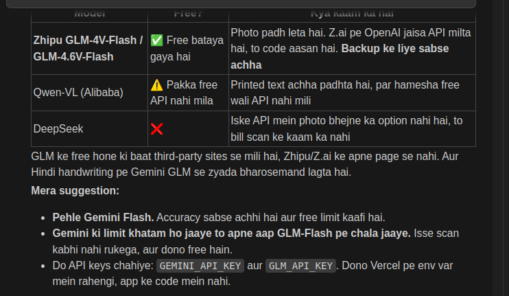

# Bill Generator – Project Plan

Ek lightweight web app jo kirana dukaandaar ke liye **Bill of Supply** banata hai. Isme ek khaas feature hai: **handwritten paper bill ko camera se scan karte hi saare items apne-aap list mein aa jaate hain**. Har item ko alag se type nahi karna padta.

- **Frontend:** React (Vite) + PWA
- **Database:** Koi nahi (sirf browser ka `localStorage`)
- **Scan / OCR:** AI Vision model (Claude / Gemini)
- **Backend:** Sirf ek serverless function (API key chhupane ke liye)

---

## 1. Features

### Core (manual)

- Rate (per kg/unit), Quantity aur Unit daal kar item add karna
- Amount ka auto calculation (Qty × Rate), aur chaahein to amount daal kar quantity nikalna
- Item list mein edit / delete
- Details form: Date, Invoice No., Shop name, Customer name/address
- **Bill of Supply** preview (Invoice No., Dated, Consignee, Buyer, items table, Total, amount in words, Declaration, Signature)
- Print / PDF download / WhatsApp share

### Advanced (scan)

- **📷 Scan Bill** button dabane pe phone ka back camera khulega
- Photo compress hokar AI ko jayegi, aur wahan se items ka JSON wapas aayega
- **Review screen**: scan se aaye items editable list mein dikhenge, aur jis item pe AI ko shak hai wo highlight hoga
- "Add All" dabane pe saare items main list mein add ho jayenge

---

## 2. OCR approach – kyun AI Vision model?

| Option                                | Handwriting accuracy                                                                                                       | Cost             | Faisla |
| ------------------------------------- | -------------------------------------------------------------------------------------------------------------------------- | ---------------- | ------ |
| Tesseract.js (browser OCR)            | Kharab, sirf printed text theek padhta hai                                                                                 | Free             | ❌     |
| Google Vision / Azure OCR             | Text padh leta hai, par item/qty/rate mein todna khud padega                                                               | Sasta            | ⚠️     |
| **AI Vision model (Claude / Gemini)** | Sabse achha. Hindi/Hinglish, "½ kg", "250 gm" aur katte hue (crossed-out) shabd bhi samajhta hai, aur seedha JSON deta hai | ~₹0.1–0.5 / scan | ✅     |

### AI se expected output

```json
{
  "items": [
    {
      "name": "Daal",
      "qty": 2,
      "unit": "kg",
      "rate": 100,
      "amount": 200,
      "uncertain": false
    },
    {
      "name": "Chawal",
      "qty": 5,
      "unit": "kg",
      "rate": 40,
      "amount": 200,
      "uncertain": false
    },
    {
      "name": "Tel",
      "qty": 1,
      "unit": "ltr",
      "rate": null,
      "amount": 180,
      "uncertain": true
    }
  ],
  "notes": ["Item 3 ka rate saaf nahi padha"]
}
```

### Prompt ke main points

- Sirf JSON lautao, koi extra text nahi
- Units ko normalize karo: `kg`, `gm`, `ltr`, `ml`, `pcs`, `pkt`
- `250 gm` ko `0.25 kg` mein badlo (rate per kg ho to)
- Katte hue (crossed-out) items aur "Total" wali line ko ignore karo
- Agar `qty × rate ≠ amount` ho, ya koi value padhi na jaaye, to `uncertain: true` lagao
- Hindi item naam ko Roman (Hinglish) mein likho, jaise "दाल" → "Daal"

---

## 3. Architecture

```
 Phone Camera
      │
      ▼
┌──────────────────────────┐
│ React App (PWA)          │
│ - Items / Scan           │  ← image browser mein compress (~200KB)
│ - Review & Edit          │
│ - Details form           │
│ - Bill preview / Print   │
│ localStorage:            │
│   shop info, invoice no. │
└────────────┬─────────────┘
             │ POST /api/scan  (base64 image)
             ▼
┌──────────────────────────┐
│ Serverless function      │  ← sirf API key chhupane ke liye
│ (Vercel / Cloudflare)    │     koi DB nahi
└────────────┬─────────────┘
             ▼
      AI Vision API  →  JSON items
```

**Serverless function kyun?** API key ko React code mein rakha to koi bhi browser DevTools se use chura sakta hai. Isliye ek chhota function (`/api/scan`) key apne paas rakhega aur photo AI ko forward karega.

**Alternative (sirf personal use ke liye):** Settings screen mein user apni API key daale aur wo `localStorage` mein save ho jaaye. Is tarah backend ki zaroorat hi nahi padegi.

---

## 4. Screens / User Flow

```
[1. Items Screen] ──📷 Scan──► [2. Review Scan] ──Add All──┐
       │  ▲                                                │
       │  └────────────────────────────────────────────────┘
       │ Proceed
       ▼
[3. Details Screen] ──Proceed──► [4. Bill Preview] ──► Print / PDF / Share
```

1. **Items Screen**: Rate, Qty, Amount, Add button, item list, 📷 Scan Bill button
2. **Review Scan Screen**: scan wali photo ka thumbnail, editable rows, ⚠️ wale rows highlighted, "Add All" / "Retake"
3. **Details Screen**: Date (default aaj ki), Invoice No. (auto +1), Shop name, Customer
4. **Bill Preview**: Bill of Supply format, Print/PDF/Share buttons

---

## 5. Tech Stack

| Kaam             | Tool                                                                           |
| ---------------- | ------------------------------------------------------------------------------ |
| Build / Dev      | Vite + React                                                                   |
| State            | React Context ya `zustand`                                                     |
| Routing          | `react-router-dom` (ya simple step-state)                                      |
| Camera           | `<input type="file" accept="image/*" capture="environment">`, koi library nahi |
| Image compress   | `browser-image-compression`                                                    |
| Amount in words  | Custom function (Indian format: hazaar, lakh, crore)                           |
| Print / PDF      | `window.print()` + print CSS; share ke liye `html2pdf.js`                      |
| Storage          | `localStorage`                                                                 |
| Install on phone | `vite-plugin-pwa`                                                              |
| Backend          | Vercel Function / Cloudflare Worker (`/api/scan`)                              |
| Styling          | Plain CSS (neumorphic design, jaisa screenshots mein hai)                      |

---

## 6. Folder Structure

```
bill-generator/
├── api/
│   └── scan.js                 # serverless: image → AI → JSON
├── public/
│   └── icons/                  # PWA icons
├── src/
│   ├── main.jsx
│   ├── App.jsx
│   ├── pages/
│   │   ├── ItemsPage.jsx
│   │   ├── ReviewScanPage.jsx
│   │   ├── DetailsPage.jsx
│   │   └── BillPreview.jsx
│   ├── components/
│   │   ├── ItemForm.jsx
│   │   ├── ItemList.jsx
│   │   ├── ScanButton.jsx
│   │   └── BillTable.jsx
│   ├── store/
│   │   └── useBillStore.js     # items, details, localStorage sync
│   ├── utils/
│   │   ├── compressImage.js
│   │   ├── amountInWords.js
│   │   └── scanBill.js         # fetch('/api/scan')
│   └── styles/
│       ├── app.css
│       └── print.css
├── .env                        # AI_API_KEY (sirf server side)
├── package.json
└── vite.config.js
```

---

## 7. Data Model (localStorage)

```js
// key: "shopInfo"
{ name: "Akhlaque Kirana Store", address: "Saraiya Varanasi 221001", mobile: "8299201035" }

// key: "lastInvoiceNo"
122

// key: "draftBill"  (app band ho jaye to data na khoye)
{
  items: [{ id, name, qty, unit, rate, amount }],
  details: { date, invoiceNo, customerName, customerAddress }
}
```

---

## 8. Development Phases

### Phase 1: Manual Bill Generator

- [x] Vite + React project setup
- [x] Items screen (add / edit / delete, auto calculation)
- [x] Details screen + localStorage
- [x] Bill of Supply preview + amount in words
- [x] Print CSS / PDF download

### Phase 2: Scan Feature

- [x] `ScanButton` (camera input + compress)
- [x] `/api/scan` serverless function + prompt
- [x] Review Scan screen (editable, uncertain highlight)
- [x] Error handling (blur photo, network fail, empty result)
- [ ] Asli Gemini key ke saath phone pe end-to-end test

### Phase 3: Accuracy Tuning

- [ ] 10–15 asli handwritten bills se test karna
- [ ] Prompt sudhaarna (Hindi naam, fractions, gm/kg)
- [ ] Dukaan ke common items ki list taaki spelling auto-correct ho

### Phase 4: Polish

- [ ] PWA (phone pe install, offline manual mode)
- [ ] WhatsApp share (Web Share API)
- [ ] Settings: shop info edit karna, invoice number reset

---

## 9. Cost Estimate

- Hosting (Vercel / Cloudflare free tier): **₹0**
- AI scan: **~₹0.1–0.5 per bill** (image compress karne se kam)
- Rozana 50 scans ke hisaab se ~₹150–750 / mahina

---

## 10. Risks & Solutions

| Risk                        | Solution                                                         |
| --------------------------- | ---------------------------------------------------------------- |
| AI galat padh le            | Review screen zaroori hai, aur doubtful items highlight honge    |
| Photo blur / andhere mein   | "Retake" option, aur photo lene ke tips                          |
| API key leak                | Key sirf serverless function mein, frontend mein nahi            |
| Internet na ho              | Manual mode offline chalega (PWA), scan ke liye internet chahiye |
| Browser data clear ho jaaye | Shop info ka export/import (JSON file) option                    |

---

## Pending Decisions

1. Handwritten bills ki bhasha kya hai: Hindi (Devanagari), English, ya mix?
   ans : mix language me hogi bill (hindi + englidh)
2. App kaun use karega: sirf aap (localStorage key) ya kai dukaandaar (serverless function)?
   ans : multiple shop pr use hoga.
3. AI provider: Claude ya Gemini?
   ans : Gemini Flash (Google AI Studio ki free key). Model ka naam `GEMINI_MODEL` env var mein rahega.
   Free limit saari dukaanon mein share hogi. Kam pade to paid tier (~₹0.1/scan) ya har dukaan ki apni key.

4. Deploy kahan karna hai: Vercel ya Cloudflare?
   ans : vercel.
   
