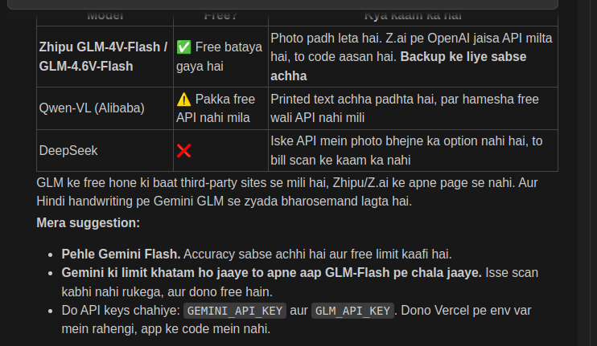

# Bill Generator – Project Plan

Ek lightweight web app jo kirana dukaandaar ke liye **Bill of Supply** banata hai. Isme ek khaas feature hai: **handwritten paper bill ko camera se scan karte hi saare items apne-aap list mein aa jaate hain**. Har item ko alag se type nahi karna padta.

- **Frontend:** React (Vite) + PWA
- **Login:** Email + password (har dukaandaar ka apna account)
- **Database:** Neon Postgres (Vercel Marketplace, free plan). Bill history yahan save hoti hai
- **Local storage:** Dukaan ki details, chalu bill (draft) aur scan ki yaaddasht phone mein bhi rehti hai, har account ki alag
- **Scan / OCR:** AI Vision model (Gemini Flash, fallback GLM)
- **Backend:** Vercel serverless functions (`/api/auth`, `/api/bills`, `/api/profile`, `/api/scan`)

---

## 1. Features

### Core (manual)

- Rate (per kg/unit), Quantity aur Unit daal kar item add karna
- Amount ka auto calculation (Qty × Rate), aur chaahein to amount daal kar quantity nikalna
- Item list mein edit / delete
- Details form: Date, Invoice No., Customer name/address/mobile (dukaan ki details Settings mein)
- **Bill of Supply** preview (Invoice No., Dated, Consignee, Buyer, items table, Total, amount in words, Declaration, Signature)
- Print / PDF download / WhatsApp share

### Advanced (scan)

- **📷 Scan Bill** button dabane pe phone ka back camera khulega
- Photo compress hokar AI ko jayegi, aur wahan se items ka JSON wapas aayega
- **Review screen**: scan se aaye items editable list mein dikhenge, aur jis item pe AI ko shak hai wo highlight hoga
- "Add All" dabane pe saare items main list mein add ho jayenge

### Account aur bill history (Phase 5)

- **Login / Signup** email + password se. PIN lock hata diya gaya hai
- Login ke bina na app khulta hai, na koi API chalti hai
- Optional **signup code** (`SIGNUP_CODE`): set ho to sirf code wale log account bana payenge
- **Bill history**: bill ka preview khulte hi bill history mein save ho jaata hai. Edit karke dobara preview karein to wahi entry update hoti hai
- **Bills page**: search (customer ka naam, mobile ya bill number), "Aur bills dikhayein" se agle 20 bills, aur har bill par actions:
  - Dekhein / PDF / WhatsApp / Print
  - Edit karein (wahi bill Home pe khulta hai, save karne pe history mein update)
  - Copy karke naya bill (wahi items, naya bill number)
  - Delete
- **Offline save**: net na ho to bill phone mein queue mein rehta hai, aur net aate hi apne aap server pe chala jaata hai. Bills tab pe peeli dot aur "Sync" button dikhte hain
- **Profile**: naam badlna, kul bills aur kul bikri, is mahine ka hisaab, password badlna, logout
- **Bottom navigation**: Home · Bills · Shops · Settings · Profile

### Shops aur rate list (Phase 6)

- **Meri Shop** (har user ki sirf 1): naam, address, shehar, mobile, UPI. Settings wali "Aapki dukaan" yahi ban jayegi, cloud mein save hogi aur phone badalne pe bhi milegi. Stamp/signature images phone mein hi rahengi (bhaari hain)
- **Items + rate list**: item add / edit / delete. Har item ka naam, unit (kg/gm/ltr/ml/pcs/pkt), fix rate, aur optional category
- **Items jaldi bharne ke tareeke**: catalog (`src/data/catalog.js`), scan ki yaaddasht (`knownItems`), aur purane bills mein aaye items se import
- **Save karte waqt Private / Public** chunna. Default **Private**
- **Permission**:
  - Edit sirf shop banane wala (owner) kar sakta hai. Server har request pe `owner_id = login user` check karega
  - **Public** shop ke items aur rate koi bhi login user dekh sakta hai, lekin edit nahi kar sakta
  - **Private** shop owner ke alawa kisi ko nahi dikhegi. Doosre user ko `404` milega, taaki ye bhi pata na chale ki shop hai
- **Public shops**: Shops tab mein saari public shops ki list, naam ya shehar se search, shop kholne pe items mein search. Har shop ka share link (`/?shop=<slug>`). Link kholne wale ko bhi login hona hoga
- **Billing se jodna**:
  - Item add karte waqt apni shop ke items sabse upar suggestions mein
  - Naam chunte hi unit aur rate apne aap bhar jayenge (zaroorat ho to badal sakte hain)
  - Scan review mein jis item ka rate khaali ho, wahan shop ka rate lag jayega
  - Rate badalne se purane bills nahi badlenge (har bill apni copy save karta hai)
- **Offline**: apni shop ki rate list phone mein cache hogi, taaki bina net ke bhi rate auto-fill chale
- **Stock on/off**: owner kisi item ko "abhi nahi hai" mark kar sake. Public view mein wo item "Stock mein nahi" dikhega, aur bill banate waqt suggestion mein bhi neeche/halka dikhega
- **Rate history + graph**:
  - Har item ke saath dikhega ki rate aakhri baar kab badla (jaise "3 din pehle")
  - Rate badalte hi purana rate history mein save ho jayega (ek din mein ek entry, pichhle 2 saal ki poori history, taaki free database bhare nahi)
  - Item pe click karne pe us item ke **rate ka graph** khulega: kab kya rate tha, sabse kam / sabse zyada rate, aur pichhli baar se kitna badla (₹ aur %)
  - Neeche poori list: date → rate
  - Public shop ki history doosre users bhi dekh sakenge (read-only)
- **Rate list share**:
  - Poori rate list ka **PDF / image** banakar WhatsApp pe bhejna (category ke hisaab se, stock wale items)
  - Dukaan pe lagane ke liye **QR poster** (A4 PDF): scan karte hi shop ki public rate list khule. Ye sirf Public shop ke liye

---

## 2. OCR approach – kyun AI Vision model?

| Option                                | Handwriting accuracy                                                                                                       | Cost             | Faisla |
| ------------------------------------- | -------------------------------------------------------------------------------------------------------------------------- | ---------------- | ------ |
| Tesseract.js (browser OCR)            | Kharab, sirf printed text theek padhta hai                                                                                 | Free             | ❌     |
| Google Vision / Azure OCR             | Text padh leta hai, par item/qty/rate mein todna khud padega                                                               | Sasta            | ⚠️     |
| **AI Vision model (Claude / Gemini)** | Sabse achha. Hindi/Hinglish, "½ kg", "250 gm" aur katte hue (crossed-out) shabd bhi samajhta hai, aur seedha JSON deta hai | ~₹0.1–0.5 / scan | ✅     |

### AI se expected output

```json
{
  "items": [
    {
      "name": "Daal",
      "qty": 2,
      "unit": "kg",
      "rate": 100,
      "amount": 200,
      "uncertain": false
    },
    {
      "name": "Chawal",
      "qty": 5,
      "unit": "kg",
      "rate": 40,
      "amount": 200,
      "uncertain": false
    },
    {
      "name": "Tel",
      "qty": 1,
      "unit": "ltr",
      "rate": null,
      "amount": 180,
      "uncertain": true
    }
  ],
  "notes": ["Item 3 ka rate saaf nahi padha"]
}
```

### Prompt ke main points

- Sirf JSON lautao, koi extra text nahi
- Units ko normalize karo: `kg`, `gm`, `ltr`, `ml`, `pcs`, `pkt`
- `250 gm` ko `0.25 kg` mein badlo (rate per kg ho to)
- Katte hue (crossed-out) items aur "Total" wali line ko ignore karo
- Agar `qty × rate ≠ amount` ho, ya koi value padhi na jaaye, to `uncertain: true` lagao
- Hindi item naam ko Roman (Hinglish) mein likho, jaise "दाल" → "Daal"

---

## 3. Architecture

```
 Phone Camera
      │
      ▼
┌──────────────────────────────┐
│ React App (PWA)              │  ← image browser mein compress (~200KB)
│ Home: Items/Scan → Details   │
│       → Bill preview         │
│ Bills · Settings · Profile   │
│ localStorage (har user alag):│
│   shop info, invoice no.,    │
│   draft, offline bill queue  │
└──────────────┬───────────────┘
               │ HttpOnly login cookie
               ▼
┌──────────────────────────────┐
│ middleware.js                │  ← login nahi to sirf /login.html
└──────────────┬───────────────┘
               ▼
┌──────────────────────────────┐        ┌──────────────────┐
│ Vercel Functions             │───────►│ Neon Postgres    │
│ /api/auth    login/signup    │        │ users, bills     │
│ /api/bills   history CRUD    │        └──────────────────┘
│ /api/profile naam, password  │
│ /api/scan    image → AI      │───────► Gemini / GLM → JSON items
└──────────────────────────────┘
```

**Serverless function kyun?** API key ko React code mein rakha to koi bhi browser DevTools se use chura sakta hai. Isliye key sirf server pe rehti hai. Database ka password (`DATABASE_URL`) bhi isi wajah se sirf server pe hai.

**Login kaise kaam karta hai:** password PBKDF2-SHA512 se hash hokar save hota hai (asli password kahin nahi). Login hone pe ek signed, HttpOnly cookie milti hai jo 30 din chalti hai. Middleware bina database ke sirf signature check karta hai, isliye fast hai. `AUTH_SECRET` badalne se sab devices logout ho jaate hain.

**Data alag-alag kaise hai:** har API query `user_id` ke saath chalti hai, isliye koi user doosre ka bill na dekh sakta hai, na badal sakta hai, na delete kar sakta hai.

---

## 4. Screens / User Flow

```
[Login / Signup]
       │
       ▼
┌─────────────────────────── Bottom nav ───────────────────────────┐
│  Home        Bills        Shops        Settings       Profile    │
└──────────────────────────────────────────────────────────────────┘

Home:
[1. Items] ──📷 Scan──► [Review Scan] ──Add All──┐
     │  ▲                                        │
     │  └────────────────────────────────────────┘
     │ Aage
     ▼
[2. Details] ──► [3. Bill Preview] ──► PDF / Print / WhatsApp / Naya bill
                        │
                        └─► history mein save (offline ho to queue)

Bills:
[List + Search] ──tap──► [Bill Viewer] ──► PDF / Print / Edit
       │
       └─⋮──► Dekhein · Edit · Copy karke naya bill · Delete

Shops (Phase 6):
[Meri Shop] ──► details + items/rate list ──► Private / Public ──► Save
     │                                                  │
     │                                                  └─► share link
     ▼
[Public Shops: List + Search] ──tap──► [Shop dekhna (read-only) + items search]
```

1. **Login page** (`public/login.html`): Login / Naya account tabs, password dikhao, signup code (agar set ho)
2. **Home → Items**: item add/edit/delete, 📷 Scan Bill, total
3. **Home → Review Scan**: photo ka thumbnail, editable rows, ⚠️ wale rows highlighted, "Add All" / "Retake"
4. **Home → Details**: Date (default aaj ki), Invoice No. (auto +1), Customer
5. **Home → Bill Preview**: Bill of Supply format, PDF/Print/WhatsApp, Naya bill
6. **Bills**: history list, search, actions, offline sync banner
7. **Settings**: stamp/signature, invoice number, backup, scan ki yaaddasht (dukaan aur UPI ab Shops → Meri Shop mein)
8. **Profile**: naam, email, stats, password badlna, logout
9. **Shops** (Phase 6): Meri Shop (banana/edit, rate list, Private/Public), Public shops ki list/search, kisi shop ka read-only view

---

## 5. Tech Stack

| Kaam             | Tool                                                                  |
| ---------------- | --------------------------------------------------------------------- |
| Build / Dev      | Vite + React 19                                                       |
| State            | `zustand` (+ `persist`, har user ki alag localStorage key)            |
| Navigation       | Simple state: bottom nav tabs + Home ke andar steps (koi router nahi) |
| Camera           | Apna `CameraScanner` component + file input fallback                  |
| Amount in words  | Custom function (Indian format: hazaar, lakh, crore)                  |
| PDF              | `html-to-image` + `jspdf` (poora bill ek hi page pe)                  |
| Print            | `window.print()` + print CSS                                          |
| Styling          | Tailwind CSS v4 + `motion` (animations) + `lucide-react` (icons)      |
| Install on phone | `vite-plugin-pwa`                                                     |
| Backend          | Vercel Functions (`api/*.js`) + Routing Middleware (`middleware.js`)  |
| Database         | Neon Postgres, driver `@neondatabase/serverless` (HTTP)               |
| Local database   | PGlite (WASM Postgres), sirf `npm run dev:local` ke liye              |
| Scan AI          | Gemini Flash (fallback: Gemini Flash Lite, phir GLM)                  |

---

## 6. Folder Structure

```
kirana-bill/
├── api/
│   ├── _auth.js                # session cookie, password hash (endpoint nahi)
│   ├── _db.js                  # Neon connection + tables apne aap banana (endpoint nahi)
│   ├── auth.js                 # login / signup / logout
│   ├── bills.js                # bill history: list, ek bill, save, delete
│   ├── shops.js                # shops: apni shop + rate list, public list, rate history
│   ├── profile.js              # profile, stats, naam, password
│   └── scan.js                 # image → AI → JSON
├── middleware.js               # login nahi to /login.html pe bhejo
├── public/
│   ├── login.html              # login / signup page (app code ke bina)
│   └── icons/                  # PWA icons
├── scripts/
│   ├── dev-local/              # npm run dev:local (Neon ki jagah PGlite)
│   ├── eval-scan.mjs           # scan accuracy check
│   └── make-test-bills.py
├── src/
│   ├── main.jsx                # pehle login check, phir app
│   ├── App.jsx                 # header, tabs, bottom nav
│   ├── pages/
│   │   ├── ItemsPage.jsx
│   │   ├── DetailsPage.jsx
│   │   ├── BillPreview.jsx
│   │   ├── BillsPage.jsx       # history list + actions
│   │   ├── BillViewer.jsx      # purana bill dekhna / PDF / edit
│   │   ├── SettingsPage.jsx
│   │   ├── ProfilePage.jsx
│   │   ├── ShopsPage.jsx       # Meri Shop / Public shops tabs
│   │   └── shops/              # MyShop.jsx, PublicShops.jsx, ShopView.jsx
│   ├── components/
│   │   ├── BottomNav.jsx
│   │   ├── BillSheet.jsx       # A4 bill, phone ke size mein fit
│   │   ├── BillExport.jsx      # PDF / print / WhatsApp (Home aur Bills dono mein)
│   │   ├── RateGraphSheet.jsx  # item ke rate ka graph + history
│   │   ├── RateListShare.jsx   # rate list PDF / image, QR poster
│   │   ├── ShopItemSheet.jsx, ImportItemsSheet.jsx, FileReadySheet.jsx
│   │   ├── BillTable.jsx
│   │   ├── CameraScanner.jsx, ScanReview.jsx
│   │   └── ItemForm.jsx, ItemList.jsx, BottomBar.jsx, BottomSheet.jsx, ...
│   ├── store/
│   │   ├── useBillStore.js     # draft, shop info, tabs, offline queue
│   │   ├── useSession.js       # logged-in user
│   │   └── useToast.js
│   └── utils/
│       ├── api.js              # fetch wrapper (logout ho to login page)
│       ├── billSync.js         # history mein save + offline queue
│       ├── shopSync.js         # apni shop load / save
│       ├── shopRates.js        # rate auto-fill, din ka number, category groups
│       ├── scanBill.js, pdf.js, whatsapp.js, backup.js, ...
├── .env                        # secrets (git mein nahi)
├── package.json
└── vite.config.js              # local pe Vercel jaisa middleware + api
```

---

## 7. Data Model

### Database (Neon Postgres) – tables pehli request pe apne aap bante hain

```sql
users (
  id          bigint primary key,
  email       text unique,          -- lowercase
  name        text,
  pass_hash   text,                 -- "pbkdf2$iter$salt$hash"
  created_at  timestamptz
)

bills (
  user_id     bigint references users on delete cascade,
  id          text,                 -- phone pe bana draft id
  invoice_no, bill_date, customer_name, customer_mobile,
  total       numeric,              -- server khud items se jodta hai
  item_count  int,
  data        jsonb,                -- { items, details, shopInfo }
  created_at, updated_at,
  primary key (user_id, id)
)
```

Upload kiya stamp/signature har bill mein nahi jaata (`'shop'` likha jaata hai). Bill dekhte waqt Settings wala stamp lagta hai.

#### Phase 6: shops

```sql
shops (
  id          bigint primary key,
  owner_id    bigint unique references users on delete cascade,  -- 1 user = 1 shop
  slug        text unique,          -- share link ke liye
  name, address, city, mobile, upi_id, upi_name, upi_mobile,
  is_public   boolean default false,
  created_at, updated_at
)

shop_items (
  id          bigint primary key,
  shop_id     bigint references shops on delete cascade,
  name        text,
  unit        text,
  rate_paise  int,                  -- ₹42.50 → 4250 (4 byte, numeric se chhota)
  category    text,
  in_stock    boolean default true, -- "abhi nahi hai" = false
  -- Rate history (graph ke liye): alag table nahi, isi row mein 2 chhote arrays
  hist_days   int[] default '{}',   -- din ka number (2025-01-01 se kitne din); last value = rate aakhri baar kab badla
  hist_paise  int[] default '{}',   -- us din ka rate paise mein (₹42.50 → 4250)
  updated_at  timestamptz
)
-- Ek shop mein same naam + unit do baar nahi: ye check server save karte waqt karta hai
-- (alag unique index nahi, taaki rename/delete ek hi save mein bina atke ho sake)
```

**Rate history kam jagah mein kaise rahegi (free 0.5 GB ke liye):**

- Alag `shop_item_rates` table **nahi** hogi. Har rate change par nayi row ~80–100 byte (row header + index) leti
- History item ki row mein hi do `int[]` arrays mein: **1 entry = 8 byte** (4 byte din + 4 byte paise)
- Rate save karte waqt:
  - Naya rate purane jaisa hai → kuch nahi judega
  - Aaj pehle hi badla tha → aaj wali entry hi update hogi (**ek din = ek entry**)
  - Warna nayi entry judegi, aur **2 saal se purani entries hat jayengi**
- Isliye ek item ki history zyada se zyada 730 entries ≈ **5.9 KB** (roz rate badle tab bhi)
- Item list ki API mein history **nahi** aayegi, sirf graph kholne par (`?history=ID`), taaki list halki rahe

| Rate kitni baar badle | 2 saal mein entries | Ek item | 100 shops × 300 items |
| --------------------- | ------------------- | ------- | --------------------- |
| Mahine mein ek baar   | 24                  | ~0.2 KB | ~6 MB                 |
| Hafte mein ek baar    | 104                 | ~0.9 KB | ~25 MB                |
| Roz (sabse bura case) | 730                 | ~5.9 KB | ~175 MB               |

API: ek nayi file `api/shops.js` (Vercel Hobby ki 12 functions limit mein rehne ke liye sab ek hi file mein)

| Request                           | Kaam                                                                                                                                          |
| --------------------------------- | --------------------------------------------------------------------------------------------------------------------------------------------- |
| `GET /api/shops?mine=1`           | Apni shop + items                                                                                                                             |
| `GET /api/shops?q=`               | Public shops ki list (search + paging)                                                                                                        |
| `GET /api/shops?slug=X`           | Ek shop + items (public ho ya apni ho, warna 404)                                                                                             |
| `GET /api/shops?history=ID`       | Ek item ki rate history (graph ke liye; public ya apni shop)                                                                                  |
| `PUT /api/shops { shop, items? }` | Apni shop banana / update (details + Private/Public) aur poori rate list. Rate list ek hi SQL statement mein save hoti hai (sab ya kuch nahi) |

Shop ka `slug` sirf pehli baar banta hai, naam badalne par bhi share link wahi rehta hai. Doosre user ko kisi shop ki UPI details kabhi nahi bheji jaati.

### localStorage (phone pe, key: `kirana-bill:<userId>`)

```js
{
  shopInfo: { name, address, city, mobile, upiId, upiName, upiMobile, stamp, signature },
  shopMeta: { slug, isPublic },          // apni shop jaisi server pe save hai (null = abhi save nahi)
  shopPublic: false,                     // Private / Public choice
  shopItems: [{ id, name, unit, rate, category, inStock, changedDay }], // rate list (billing mein auto-fill, offline bhi)
  shopDirty: false,                      // Save baaki hai
  lastInvoiceNo: 122,
  draftId: "m3x...",                     // chalu bill ki id (history mein isi naam se)
  items: [{ id, name, qty, unit, rate, amount }],
  details: { date, invoiceNo, customerName, customerAddress, customerMobile },
  pendingBills: { "<id>": { ...bill } }, // offline bane bills, net aate hi sync
  knownItems: [...], nameFixes: {...}    // scan ki yaaddasht
}
// key: "kb_user" → last logged-in user (offline app kholne ke liye)
```

Login se pehle ka purana data (`kirana-bill` key) us phone pe login karne wale pehle account ko mil jaata hai.

---

## 8. Development Phases

### Phase 1: Manual Bill Generator

- [x] Vite + React project setup
- [x] Items screen (add / edit / delete, auto calculation)
- [x] Details screen + localStorage
- [x] Bill of Supply preview + amount in words
- [x] Print CSS / PDF download

### Phase 2: Scan Feature

- [x] `ScanButton` (camera input + compress)
- [x] `/api/scan` serverless function + prompt
- [x] Review Scan screen (editable, uncertain highlight)
- [x] Error handling (blur photo, network fail, empty result)
- [ ] Asli Gemini key ke saath phone pe end-to-end test

### Phase 3: Accuracy Tuning

- [ ] 10–15 asli handwritten bills se test karna (`npm run eval -- <folder>`, neeche dekhein)
- [x] Prompt sudhaarna (Hindi naam, fractions, gm/kg, हिंदी अंक, पौना/साढ़े, ditto 〃, नग, udhaar/total ignore)
- [x] Dukaan ke common items ki list taaki spelling auto-correct ho (`src/data/catalog.js`)
- [x] Owner ki galti-sudhaar yaad rakhna (agli baar wahi naam apne aap theek) + dukaan ke apne items AI ko hint
- [x] Accuracy check script: `npm run eval` (4 nakli bills par 130/130 fields sahi)

**Asli bills test karne ka tareeka:**

1. Photos ek folder mein rakhein, jaise `real-bills/`.
2. `npm run eval -- real-bills` chalayein. Har photo ka scan `real-bills/answers.todo.json` mein likha jaayega.
3. Us file mein galtiyan theek karke entries ko `real-bills/answers.json` mein daal dein.
4. Ab `npm run eval -- real-bills` chalane pe har photo ka score aur galat fields dikhenge. Prompt badalne ke baad yahi dobara chalayein.

### Phase 4: Polish

- [x] PWA: phone pe install (icon, full screen) aur offline manual mode. Online pe login check hamesha chalta hai; offline mein pichhla login maana jaata hai
- [x] WhatsApp share: PDF ke saath bill ka message, customer ka mobile ho to seedha unki chat
- [x] Settings: dukaan, UPI, stamp/signature, agla invoice number / 1 se shuru, scan ki yaaddasht
- [x] Backup / restore (JSON file: dukaan, bill number, scan ki yaaddasht, chalu bill)
- [ ] Asli phone pe test: install, offline, WhatsApp share (deploy ke baad, HTTPS chahiye)

### Phase 5: Accounts + Bill History

- [x] Neon Postgres (Vercel free) + tables apne aap banana
- [x] Login / Signup (email + password), PIN lock hataya, optional `SIGNUP_CODE`
- [x] Middleware: login ke bina app aur API band
- [x] Bottom navigation: Home · Bills · Settings · Profile
- [x] Bill preview pe history mein save (same draft = same entry), offline queue + auto sync
- [x] Bills page: search, paging, dekhna / PDF / WhatsApp / print, edit, copy karke naya bill, delete
- [x] Profile: naam, stats (aaj + is mahine + kul, India ke time se; average bill), password badlna (alag sheet mein), jaldi links (Meri Shop, Mere bills, Settings), app install button (jahan browser de), doston ko app ka link, logout
- [x] Har account ki alag local data (shop info, draft) same phone pe
- [x] `npm run dev:local`: bina Neon ke local testing (PGlite, data `.pglite/` mein)
- [x] API tests (PGlite pe): signup/login, paging, search, edit, delete, profile, user isolation
- [x] Vercel pe Neon database banana + deploy + asli phone pe test
- [x] Shop info cloud mein sync (Phase 6: Shops → Meri Shop)
- [ ] Scan ki yaaddasht bhi cloud mein sync (abhi sirf phone mein, Backup se le ja sakte hain)
- [ ] Password bhool gaye? (email reset ke liye email service chahiye)
- [ ] Password badalne pe baaki devices se logout

### Phase 6: Shops + Rate List

- [x] `shops` + `shop_items` tables, `api/shops.js` (har edit pe owner check, private shop doosre ko 404)
- [x] Bottom nav mein **Shops** tab (Home · Bills · Shops · Settings · Profile)
- [x] Meri Shop: banana / edit, items add / edit / delete, har item ka rate list mein hi fix, Private / Public, Save
- [x] Items import: catalog + aapke bills/scan mein aaye naam (`knownItems`)
- [x] Public shops: list + search (naam / shehar) + share link (`/?shop=<slug>`)
- [x] Kisi shop ko dekhna (read-only) + items mein search + call button
- [x] Settings ki "Aapki dukaan" aur UPI ab Meri Shop mein; pehli baar purana local data form mein bhara milta hai, Save pe cloud mein
- [x] Item form mein shop ka rate auto-fill (unit + rate + amount), scan mein khaali rate pe shop ka rate; rate list phone mein bhi (offline)
- [x] **Stock on/off**: "abhi nahi hai" mark karna, public view aur bill item form mein dikhe
- [x] **Rate kab badla**: har item pe "rate X din pehle badla", history `hist_days` / `hist_paise` arrays mein (ek din = ek entry, 2 saal)
- [x] **Rate graph**: item pe click karne pe step graph (crosshair + tooltip), sabse kam / zyada, pichhli baar se badlav (₹ / %), date → rate list
- [x] **Rate list share**: PDF / image (category ke hisaab se, stock wale items), WhatsApp / share
- [x] **QR poster**: A4 PDF, scan karte hi shop khule (sirf Public shop)
      animate={{ opacity: 1, y: 0 }}
      exit={{ opacity: 0, x: -40 }}
- [x] Tests (PGlite): sirf owner edit kar sake, private shop + uski history doosre ko 404, public read-only, doosre ki item id se kuch na badle, history ke niyam (ek din = ek entry, 2 saal)
- [x] Meri Shop UX: rate list sabse upar; dukaan / UPI / Private-Public ek band card mein (nayi shop pe khula); search hamesha (scroll pe upar chipka); filter chips: Sab · Rate baaki · Stock mein nahi · har category; "+ Item" Save ke saath neeche; search mein na mile to "'xyz' naya item jodein"; share (PDF / image / QR) upar ek button mein
- [x] UI test (headless Chrome): shop banana → import → rate → Public → Save → graph → PDF/QR → billing auto-fill → doosra user dekhe (edit nahi) → share link → Private pe "nahi mili"
- [ ] Asli phone pe test (Vercel deploy ke baad)

### Phase 6.1: Qty ke hisaab se rate (slab rate)

Ek item ke kai rate, customer kitni qty le raha hai uske hisaab se. Misaal (rate per kg):

| Slab           | Rate   |
| -------------- | ------ |
| 5 kg ya zyada  | ₹65/kg |
| 1 kg ya zyada  | ₹66/kg |
| 250 g ya zyada | ₹70/kg |
| Isse kam       | ₹80/kg |

**Niyam (tay ho chuke):**

- Har slab "itna ya zyada" hai. Qty se chhoti ya barabar wali sabse badi slab ka rate lagega, aur sabse neeche wala rate baaki sab ke liye (150 g / 200 g → ₹80)
- Rate graph aur history mein sirf **main rate** (1 unit wala, upar misaal mein ₹66) dikhega, taaki storage na badhe
- Bill mein qty usi unit mein jo bechi: **`250 gm @ ₹70/kg = ₹17.50`**. gm ↔ kg aur ml ↔ ltr app khud badlega

**Database:** `shop_items` mein 2 aur chhote arrays (ek slab = 8 byte):

```sql
slab_qty    int[] default '{}',   -- slab ki shuruat, chhoti unit mein (5 kg → 5000 g, 250 g → 250)
slab_paise  int[] default '{}'    -- us slab ka rate paise mein, item ki unit ke hisaab se (₹65/kg → 6500)
-- khaali = ek hi rate (rate_paise), purane items waise hi chalte rahenge
```

**Kaam:**

- [x] `shop_items` mein `slab_qty` / `slab_paise` (purane database mein `alter table ... add column if not exists`), API validation (pehla slab 0 se, qty badhte kram mein, rate > 0, max 6 slab); main rate = 1 unit wala, server khud nikalta hai
- [x] Meri Shop: item sheet mein "Qty ke hisaab se alag rate" (qty + gm/kg chunke slab jodein / hatayein, 1 unit ka rate preview), list mein "₹66 · 4 rate" badge
- [x] Bill item mein `rateUnit` (rate kis unit ka hai); amount = qty (rate ki unit mein badal ke) × rate. Purane bill items (bina `rateUnit`) waise hi chalte hain
- [x] Item form: naam + qty daalte hi sahi slab ka rate, neeche "250 g+ slab: ₹70/kg · 1 kg+ pe ₹66/kg" hint; qty / unit badle to rate bhi badle; "Rate/" ke saath kg ↔ gm chunne ka option
  - [x] Rate haath se badla to auto-fill ruk jaye; "Shop ka rate lagayein" se phir chalu
  - [x] Pehle amount daala ("₹20 ka de do"): wo slab chuno jisme amount ÷ rate wali qty theek baithe (₹20 ÷ ₹70/kg = 286 g → 250 g+ slab)
- [x] Scan: khaali rate pe qty ke hisaab se slab ka rate (gm/kg badal ke); pcs jaise na badalne wale units pe kuch nahi
- [x] Bill table / PDF: `250 gm · ₹70.00 · kg` (rate ki unit wale column mein `rateUnit`)
- [x] Public shop view + rate list PDF/image mein slabs ("5 kg+ ₹65 · 1 kg+ ₹66 · 250 g+ ₹70 · kam ₹80")
- [x] Tests: slab chunna (6 kg / 5 kg / 2 kg / 1 kg / 500 g / 250 g / 200 g / 150 g / 100 g), "₹20 ka", gm↔kg, ml↔ltr, API validation, sirf slab badle to history mein nayi entry nahi, wapas single rate; UI test (shop → slabs → Save → bill form → bill table)
- [ ] Asli phone pe test (Vercel deploy ke baad)

**Phase 6 ke baad ke ideas (Later):**

- [ ] **Ek click mein rate badlna**: poori category ya saare items pe +5% / −₹2
- [ ] **Favourite shops**: doosri public shops save karna
- [ ] **Public mein kya dikhe**: owner tay kare, jaise mobile number / address chhupana
- [ ] **Report / block**: galat ya spam public shops ke liye

### Phase 7 (planned): Free database mein zyada bills

Bills sabse zyada jagah lete hain (~3 KB/bill). 10 dukaanein × 30 bills/din ≈ 330 MB/saal, jo free 0.5 GB jaldi bhar dega.

- [ ] Bill ke items chhote format mein save karna (keys ki jagah array: `["Chawal", 2, "kg", 4250, 8500]`, rate/amount paise mein)
- [ ] `data` mein se wo cheezein hatana jo har bill mein same hain (shop ka naam/address/UPI: shop table se aa jaye)
- [ ] Profile mein "Database kitna bhara" dikhana (`pg_database_size`), 80% pe chetavani
- [ ] Bahut purane bills (jaise 2 saal+) ka sirf summary rakhna, poora bill PDF/Backup se download karke

---

## 9. Setup & Testing

### Environment variables (`.env` local, Vercel → Settings → Environment Variables)

| Variable                                                            | Kaam                                                                     |
| ------------------------------------------------------------------- | ------------------------------------------------------------------------ |
| `AUTH_SECRET`                                                       | Login cookie sign karne ke liye (`openssl rand -hex 32`)                 |
| `DATABASE_URL`                                                      | Neon connection string (Vercel Neon connect karne pe khud set karta hai) |
| `SIGNUP_CODE`                                                       | Optional. Set ho to signup ke liye ye code chahiye                       |
| `GEMINI_API_KEY`                                                    | Scan ke liye (Google AI Studio free key)                                 |
| `GEMINI_MODEL`, `GEMINI_FALLBACK_MODEL`, `GLM_API_KEY`, `GLM_MODEL` | Scan models / fallback                                                   |

`APP_PIN` ab use nahi hota.

### Local pe chalana

| Kaam                          | Command                                          |
| ----------------------------- | ------------------------------------------------ |
| Bina Neon ke (local database) | `npm run dev:local`                              |
| Phone pe test (same WiFi)     | `npm run dev:local -- --host`                    |
| Local database saaf karna     | `npm run dev:local:reset`                        |
| Asli Neon ke saath            | `.env` mein `DATABASE_URL` daal ke `npm run dev` |

### Deploy (Vercel)

1. Vercel → project → **Storage → Create Database → Neon** → project se connect (Development bhi tick karein)
2. `AUTH_SECRET` set ho, `APP_PIN` hata dein, chaahein to `SIGNUP_CODE` daalein
3. Deploy. Pehli baar sab users ko account banana hoga (purana PIN ab kaam nahi karta)

---

## 10. Cost Estimate

- Hosting (Vercel Hobby): **₹0**
- Database (Neon free plan, ~0.5 GB): **₹0**. Ek bill ~2–5 KB, to 1 lakh+ bills aa jaate hain
- AI scan: **~₹0.1–0.5 per bill** (Gemini free key ki daily limit tak ₹0)
- Rozana 50 scans (paid tier pe) ~₹150–750 / mahina

---

## 11. Risks & Solutions

| Risk                                        | Solution                                                             |
| ------------------------------------------- | -------------------------------------------------------------------- |
| AI galat padh le                            | Review screen zaroori hai, aur doubtful items highlight honge        |
| Photo blur / andhere mein                   | "Retake" option, aur photo lene ke tips                              |
| API key / DB password leak                  | Sirf serverless function mein, frontend mein nahi                    |
| Internet na ho                              | Manual mode offline chalega (PWA); bill queue mein, net aate hi sync |
| Browser data clear ho jaaye                 | Bills server pe safe; shop info ke liye Backup (JSON file)           |
| Koi bhi signup karke scan quota kharch kare | `SIGNUP_CODE` set karein                                             |
| Password guess karna                        | Hash (PBKDF2), har galat try pe der, 5 galat try pe 5 minute rok     |
| Ek user doosre ka data dekhe                | Har query `user_id` se bandhi; isolation tests pass                  |
| Private shop doosre ko dikh jaaye (Phase 6) | Server pe owner check; private shop doosre ko 404, list mein nahi    |
| Koi doosre ki shop edit kare (Phase 6)      | Har edit request pe `owner_id = login user`, warna mana              |
| Purana / galat rate (Phase 6)               | Har item pe "rate kab badla" date; bill mein rate badal sakte hain   |
| Spam / nakli public shops (Phase 6)         | `SIGNUP_CODE`, aur baad mein Report / block                          |

---

## Pending Decisions

1. Handwritten bills ki bhasha kya hai: Hindi (Devanagari), English, ya mix?
   ans : mix language me hogi bill (hindi + englidh)
2. App kaun use karega: sirf aap (localStorage key) ya kai dukaandaar (serverless function)?
   ans : multiple shop pr use hoga. Har dukaan ka apna login account.
3. AI provider: Claude ya Gemini?
   ans : Gemini Flash (Google AI Studio ki free key). Model ka naam `GEMINI_MODEL` env var mein rahega.
   Free limit saari dukaanon mein share hogi. Kam pade to paid tier (~₹0.1/scan) ya har dukaan ki apni key.

4. Deploy kahan karna hai: Vercel ya Cloudflare?
   ans : vercel.
   

5. Database kaun sa?
   ans : Neon Postgres (Vercel Marketplace, free). Local testing ke liye PGlite (`npm run dev:local`).
6. Login kis se?
   ans : Email + password. PIN lock hata diya.
7. Shops (Phase 6) kaise kaam karengi?
   ans : Ek user ki sirf 1 shop. Shop ki rate list billing se judegi (item chunte hi rate auto-fill).
   Public shops ki list + search + share link. Settings wali "Aapki dukaan" shop se judegi aur cloud mein save hogi.
